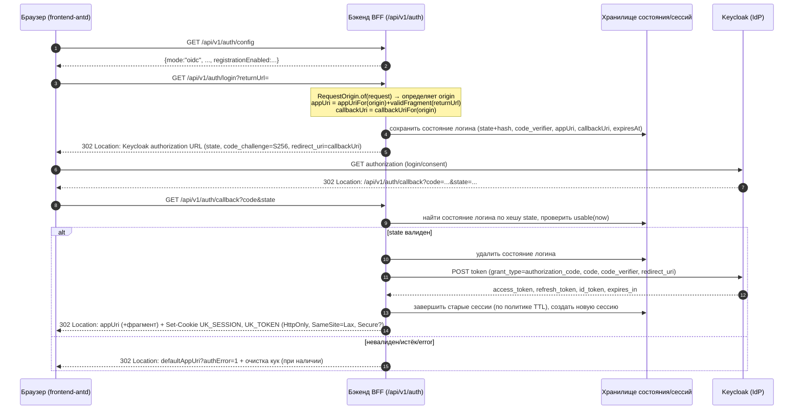
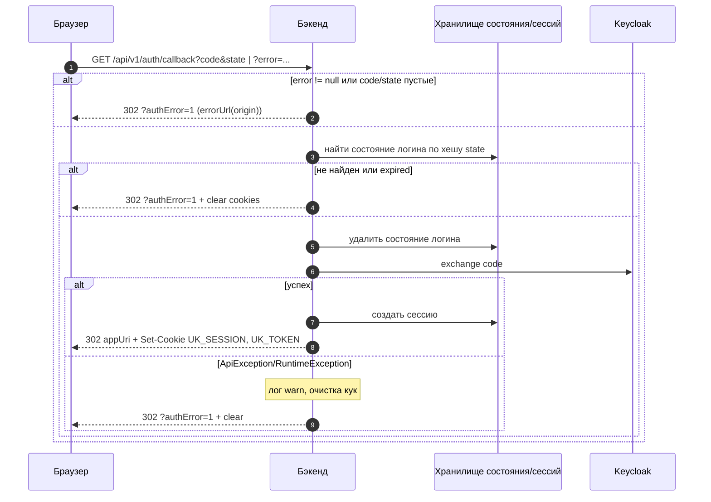
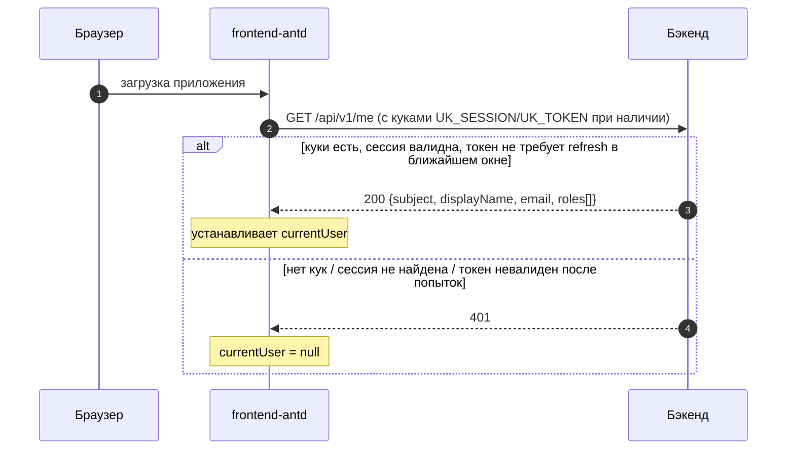
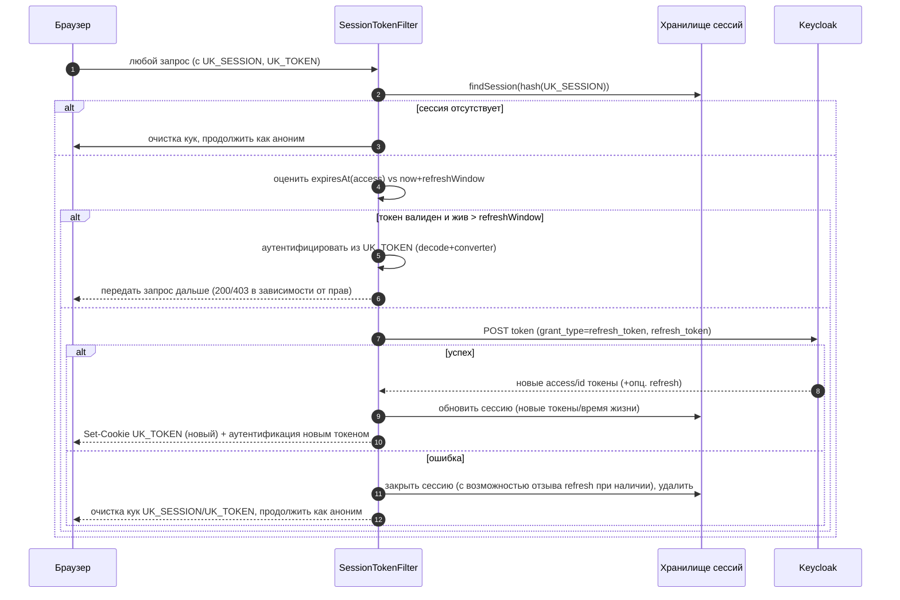
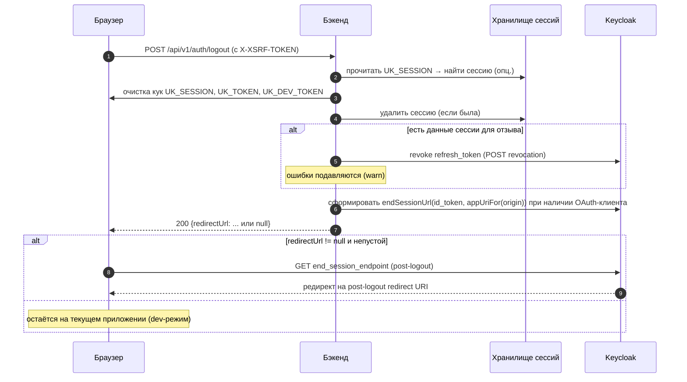
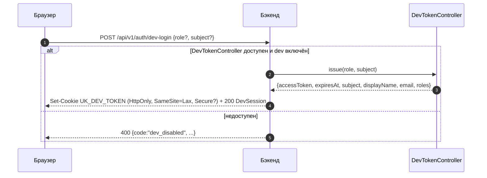

# Диаграммы потоков авторизации

Все диаграммы — Mermaid `sequenceDiagram`. Язык русскоязычных комментариев/названий осознанно смешан с техническими идентификаторами/путями как в коде.

## 1. Вход (OIDC Authorization Code + PKCE через BFF)

## 2. Завершение логина (callback) — детали обработки ошибок

## 3. Восстановление сессии при загрузке страницы

## 4. Автоматическое обновление токена (refresh) до истечения

## 5. Выход (logout) с ревокацией и post-logout redirect

## 6. Dev-login

## Примечания к диаграммам

- Обмен кода на токены всегда выполняется **бэкендом**, не браузером (BFF).
- `state` хранится в виде хеша в хранилище состояния логина; одноразовый.
- `returnUrl` — только **локальный фрагмент**.
- `UK_TOKEN` обновляется через `Set-Cookie` в ответе при refresh.
- CSRF применяется к не-GET (кроме запросов с `Authorization` header).